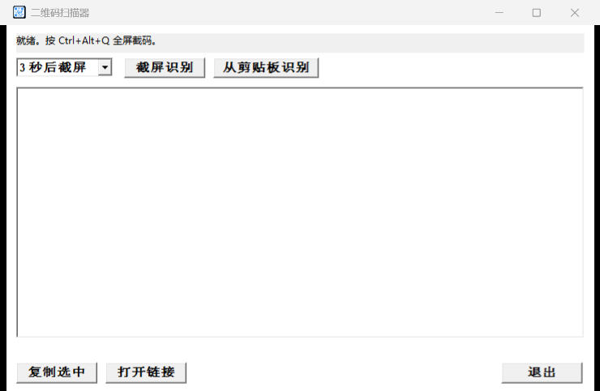

# Screen QR Scanner

Windows 桌面二维码扫描器：**原生 C 单文件，209 KB，免安装、零依赖**。屏幕上出现二维码，按一下全局热键，自动截屏解码，第一个结果直接进剪贴板。



## 功能

- **全局热键 `Ctrl + Alt + Q`**：窗口自动隐藏 → 倒计时 → 截取整个虚拟桌面 → 解码 → 窗口回到前台显示结果。
- **同屏多个码全收**：不是只找第一个，结果列表可逐个复制或打开。
- **多显示器支持**：抓取整个虚拟桌面，不局限于当前屏幕。
- **反色自动重试**：白底黑码、黑底白码都能解。
- **剪贴板识别**：系统截图工具复制的图（CF_DIB / CF_BITMAP），点一下就能解。
- **网址一键打开**：识别结果以 `http(s)://`、`mailto:`、`workbuddy://` 开头时显示「打开链接」按钮。
- **本地记录**：每次扫描写入 `scan_log.txt`，不联网、不上传。
- **倒计时可选**：窗口里选 2 / 3 / 5 秒。

## 快速开始

双击 `启动-二维码扫描器.bat`，或桌面上的 `二维码扫描器` 快捷方式。不用 Python，不用安装任何东西。

关闭窗口只是隐藏到托盘；彻底退出请点窗口里的「退出」。

## 使用

| 操作 | 效果 |
|---|---|
| 按 `Ctrl + Alt + Q` | 3 秒倒计时后截屏识别（软件运行时才有效） |
| 窗口里选 2/3/5 秒 | 改倒计时长度 |
| 点「截屏识别」 | 同上，用鼠标触发 |
| 点「从剪贴板识别」 | 识别系统截图工具复制的图片 |
| 点结果下的「复制 / 打开链接」 | 处理指定结果 |
| 点「退出」 | 结束进程、退出托盘 |

## 文件构成

| 文件 | 说明 |
|---|---|
| `Native/scanner.exe` | 程序本体，209 KB，可单独拷走使用 |
| `Native/scanner.c` | 全部 Win32 + quirc 实现源码 |
| `Native/quirc/` | quirc 解码库源码（纯 C） |
| `Native/app.ico` | 蓝色二维码图标 |
| `app.ico` / `desktop.ini` | 顶层图标与文件夹图标 |
| `make_icon.py` | 图标生成脚本（需 Pillow，仅改配色时用得上） |

## 重新编译

工具链用的是本机 `D:\AI\HoD_Portable\Build` 里的 clang 20 + 便携 MSVC 14.44 + Windows SDK：

```bat
set INCLUDE=<MSVC>\include;<SDK>\Include\10.0.26100.0\ucrt;<SDK>\Include\10.0.26100.0\shared;<SDK>\Include\10.0.26100.0\um
set LIB=<MSVC>\lib\x64;<SDK>\Lib\10.0.26100.0\ucrt\x64;<SDK>\Lib\10.0.26100.0\um\x64
clang.exe -target x86_64-pc-windows-msvc -O2 -Iquirc -Xlinker /SUBSYSTEM:WINDOWS ^
  scanner.c quirc/lib_quirc.c quirc/lib_decode.c quirc/lib_identify.c quirc/lib_version_db.c ^
  -luser32 -lgdi32 -lshell32 -lcomctl32 -o scanner.exe
```

## 许可

MIT
